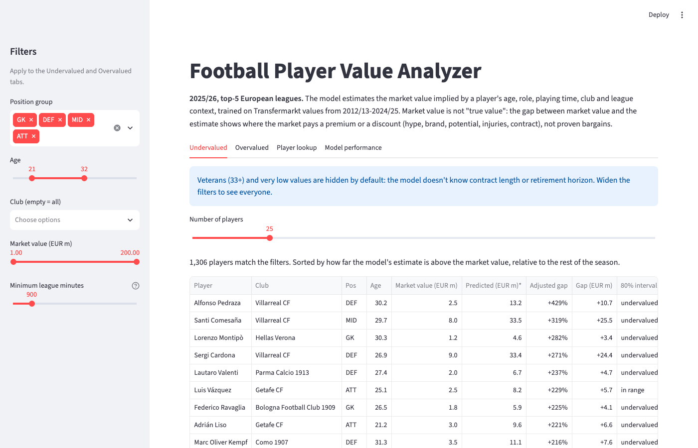
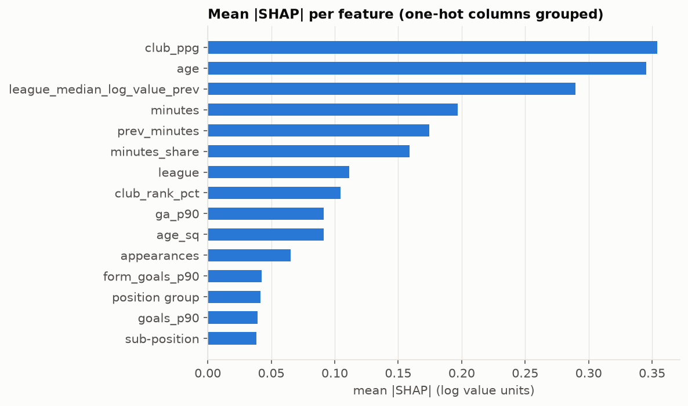

# Football Player Value Analyzer

**Estimates what a top-5-league footballer's market value "should" be from age, role, playing time, club and league context, then shows where the market pays a premium or a discount, with a backtest that checks whether those gaps mean anything.**

> **Live demo:** _add your Streamlit Community Cloud link here after deploying (see [Deploy](#deploy-to-streamlit-community-cloud))._

<!-- Demo GIF placeholder: record the app (Undervalued tab -> Player lookup -> Model performance) and save it as
     reports/figures/demo.gif, then replace the screenshot below with  -->


**Honest framing.** Market value is not "true value". The model estimates a *context- and performance-implied* value
learned from Transfermarkt's own valuations. The gap between market value and that estimate shows where the market
pays a premium or a discount (hype, brand, potential, injuries, contract). It does not prove that a player is a
bargain. A backtest (below) tests the claim instead of assuming it.

## Results at a glance

Test season **2025/26** (1,964 player-seasons), evaluated **exactly once**, after every modelling choice had been made on cross-validation:

| Model | RMSE (log) | R² (log) | Median abs. % error | Within 50% of market value | CV RMSE (log) |
|---|---|---|---|---|---|
| Median by position × age band (baseline) | 1.157 | 0.13 | 66% | 33% | 1.167 |
| Ridge: age + position only (baseline) | 1.129 | 0.17 | 65% | 35% | 1.143 |
| Ridge: all features | 0.560 | 0.80 | 35% | 70% | 0.556 |
| **XGBoost: all features (main)** | **0.500** | **0.84** | **30%** | **77%** | **0.502** |
| XGBoost: player-only + league market level | 0.666 | 0.71 | 39% | 63% | 0.679 |

- Test RMSE matches cross-validation for every model (largest gap 0.014), so there is no sign of overfitting to the validation folds.
- The main model's **80% prediction interval covers 81.4%** of test players (after a conformal correction; raw quantile intervals covered only ~74–75%).
- **Weak spot:** the main model under-predicts the whole 2025/26 season by about 14% (mean log bias −0.153 vs −0.067 in CV), because market prices rose faster than the model's lagged market level. Gaps and flags are therefore centred on each season's median (see [Approach](#approach)).

**Backtest (2021/22–2024/25, out-of-fold):** players flagged *undervalued* lost **about 12–17% less market value over the
next 12 months** than comparable players (same season, position and age band). The effect survives removing veterans
and very cheap players and pessimistic bounds for missing outcomes. The continuous gap is only a weak predictor
(Spearman 0.08), and the effect is best explained as **mean reversion in Transfermarkt values**, not proven bargains.

## Key findings

**Premier League 2025/26, with the app's default filters** (age 21–32, market value ≥ €1M, ≥ 900 league minutes; season-centred estimates):

| Model above market | Club | Age | Market | Estimate | Gap |
|---|---|---|---|---|---|
| Luke Shaw | Manchester United | 30.9 | €8.0M | €20.3M | +154% |
| Josh Laurent | Burnley | 31.1 | €1.5M | €3.0M | +103% |
| Jacob Bruun Larsen | Burnley | 27.7 | €4.0M | €8.1M | +102% |
| Omar Alderete | Sunderland | 29.4 | €13.0M | €25.8M | +99% |
| Leandro Trossard | Arsenal | 31.5 | €18.0M | €33.3M | +85% |

| Market above model | Club | Age | Market | Estimate | Gap |
|---|---|---|---|---|---|
| Reece James | Chelsea | 26.5 | €60.0M | €21.1M | −65% |
| Jhon Arias | Wolverhampton | 28.7 | €15.0M | €5.5M | −64% |
| Sandro Tonali | Newcastle | 26.1 | €80.0M | €30.2M | −62% |
| Oscar Bobb | Fulham | 22.9 | €28.0M | €11.4M | −59% |
| Tino Livramento | Newcastle | 23.6 | €45.0M | €18.9M | −58% |

How to read these: the "market above model" list is full of players whose price reflects things the model cannot see
(potential, international status, injury history priced in differently, contract situation). The "model above market"
list leans towards players around 30 at clubs with strong seasons. Without the default filters, the top of that list
is dominated by 35+ veterans (Karl Darlow, Adam Smith, Idrissa Gueye, Martin Dúbravka), which is an artifact: the
model knows nothing about contract length or retirement horizon.

**What drives the model (SHAP, mean |SHAP| in log units):** club points per game 0.35, age 0.35, league market level
0.29, league minutes 0.20, previous-season minutes 0.17, share of available minutes 0.16; goals + assists per 90 only
0.09. SHAP values show association with the model's output, not causation, and describe the model rather than
football. The estimate is mostly *context-implied* rather than *performance-implied*.



**Backtest robustness** (pooled, season-centred flags; log change over the next ~12 months, 0.10 ≈ +10%; 95% CIs from
a bootstrap that resamples whole players):

| Specification | Undervalued vs matched peers | Undervalued (regression) | Overvalued vs matched peers | Overvalued (regression) |
|---|---|---|---|---|
| Main (5,904 player-seasons) | +0.160 [0.117, 0.206] | +0.121 [0.076, 0.163] | −0.075 [−0.111, −0.043] | −0.031 [−0.067, 0.001] |
| (a) age 21–32 | +0.187 [0.137, 0.234] | +0.151 [0.101, 0.197] | −0.091 [−0.125, −0.055] | −0.048 [−0.081, −0.013] |
| (b) market value ≥ €2M | +0.154 [0.104, 0.206] | +0.120 [0.066, 0.173] | −0.069 [−0.102, −0.034] | −0.035 [−0.069, −0.000] |
| (c) both | +0.166 [0.113, 0.222] | +0.137 [0.084, 0.190] | −0.086 [−0.121, −0.051] | −0.054 [−0.090, −0.020] |
| (i) missing outcome = season 10th pct | +0.111 [0.068, 0.153] | +0.103 [0.060, 0.147] | −0.057 [−0.087, −0.025] | −0.049 [−0.082, −0.016] |
| (ii) missing outcome = season 25th pct | +0.127 [0.087, 0.167] | +0.102 [0.062, 0.143] | −0.065 [−0.095, −0.033] | −0.039 [−0.070, −0.007] |

Regression: change in log value ~ flags + age + age² + position + current log value + season fixed effects.

**Conclusion.** Players the model flags as undervalued go on to lose about 12–17% less market value over the next
12 months than comparable players. This holds after excluding veterans and very cheap players, and under pessimistic
assumptions for players with no later valuation; the overvalued effect is about half as large and less certain. This
shows that Transfermarkt values tend to move toward the model's estimate (mean reversion in a noisy, partly
self-correcting valuation process), not that flagged players are proven bargains in real transfer fees: the model
learned Transfermarkt's own pricing, and the player-level gap is a weak signal (Spearman 0.08 [0.05, 0.11]; per season
0.17, 0.05, 0.07, 0.03).

## Approach

**Data.** [Transfermarkt open dataset](https://github.com/dcaribou/transfermarkt-datasets) (games, appearances,
player valuations, players; data to June 2026). One row = one player in one top-5-league season (Premier League,
LaLiga, Serie A, Bundesliga, Ligue 1). Training uses all five leagues for more data; the analysis focuses on the
Premier League.

| Filter | Rows |
|---|---|
| All top-5 league player-seasons 2012/13–2025/26 | 36,669 |
| ≥ 450 league minutes | 27,436 |
| Known position and birth date | 27,405 |
| Valuation in the target window | **26,894** |

**Target.** `log(market value in EUR)` of the player's **first valuation on or after their last league game of
season S**, no later than 31 October of the next year. Transfermarkt mostly revalues in late May/June, *before*
30 June, so a window anchored on 30 June would have missed almost every recent season. The median gap between last
game and valuation is 13–24 days in recent seasons. Taking the first valuation after the last game means the market
had seen every game the features use. Log because values are heavily right-skewed (median €5M, max €200M).

**Features** (48; all computed only from games dated on or before the row's valuation date):
- Profile: age, age², height, position group, sub-position, preferred foot.
- Season S: league minutes, appearances, share of available minutes, goals / assists / goal contributions / yellow
  and red cards per 90 (minutes floored at 90 so a cameo goal is not "9 goals per 90").
- Season S−1 (any domestic league in the dataset) plus a 2-season form = ⅔ current + ⅓ previous per-90; missing
  previous season → NaN + flag (2012/13 has none by construction).
- Context: club points per game and league rank *as of the valuation date*, league, and
  `league_median_log_value_prev` (the median log value of that league's previous-season rows, a league-level
  measure of market inflation; never the player's own value).
- Deliberately excluded: the player's own current or past market value, contract expiry and current club (these exist
  only as of today's snapshot, so using them for past seasons would be a time mismatch).

**Split.** Time-based only. Expanding-window CV validates on 2021/22, 2022/23, 2023/24 and 2024/25, each fold trained
on earlier seasons only (and purged of any training target dated after the first validation target). Final models are
refit on 2012/13–2024/25. **2025/26 is the test season and was evaluated exactly once**; a guard refuses to re-run the
evaluation.

**Models.** Two baselines (median by position × age band; Ridge on age + position), Ridge on all features, XGBoost
(48-configuration grid, fixed tree counts, no early stopping on validation folds), and an XGBoost
"player-only + league market level" variant without club strength or league identity. 80% intervals come from XGBoost
quantile models (10th/90th percentile) widened by a conformal correction learned from out-of-fold errors of
earlier folds.

**Gaps and flags.** `raw gap = log(prediction) − log(market value)`. Because the model can be off for a whole season,
the **adjusted gap** subtracts the season's median raw gap (centring uses only that season's cross-section). A player
is flagged undervalued/overvalued only if the market value is outside the equally shifted 80% interval **and** they
played at least 900 league minutes.

**Leakage tests.** `pytest` (36 tests) includes a fixture with a player injured in March whose club keeps playing:
altering any game, appearance or valuation dated after that player's valuation must leave their features unchanged.
The test fails if club strength is computed from the full season (checked by breaking the code on purpose).

## Where it fails

From the 2025/26 test season (main model):

- **The whole season is under-predicted by ~14%** (bias −0.153 vs −0.067 in CV). Raw flags would label 231 players
  overvalued and only 61 undervalued; season-centred flags give 121 and 129.
- **Young players (≤ 21)**: worst RMSE (0.645) and ~34% too low on average (bias −0.41). Potential is invisible to
  match statistics (e.g. Estêvão: €80M market value vs €17.5M estimate).
- **Stars (≥ €50M)**: ~33% too low on average (bias −0.40). The model ranks them sensibly but compresses the top of
  the scale.
- **Veterans (33+)**: slightly over-predicted and they dominate the raw "undervalued" list, because contract length
  and retirement horizon are unknown to the model.
- **Players with 450–899 minutes** (injured or on the bench): RMSE 0.61, only 67% within 50%; their value reflects
  earlier status. They are never flagged.
- **Goalkeepers** are *not* worse on aggregate (RMSE 0.52, bias −0.03), but their estimate rests on minutes, height
  and club, not on goalkeeping ability.

## What failed / what I learned

- **The obvious target window was wrong.** "Valuation within 90 days after 30 June" covered 0–3% of recent
  seasons, because Transfermarkt revalues before 30 June. Inspecting the data before modelling saved the project.
- **Market inflation is the core problem.** Median values went from €3.0M (2012/13) to €7.5M (2024/25), and the
  Premier League median from about €4.5M to €20M. The first baseline was 34–38% too low on every recent season. A
  linear season trend did not help (RMSE unchanged, bias flipped to about +10%); a lagged league market level did, in CV,
  but not fully in the test season.
- **Full-season club strength leaks the future** for players whose season ended early. Club points per game and
  rank are now computed as of the valuation date, and a test proves it.
- **Raw quantile intervals were over-confident** (74–75% coverage for a nominal 80%); a conformal correction fixed
  it (79–81% in CV, 81.4% on test).
- **A "player-only" model without any market level was biased by −0.32** because it could not follow inflation;
  adding back the league-level market level fixed the bias (−0.05 in CV).
- **Performance stats add surprisingly little.** In a Ridge ablation, dropping age/height costs +0.26 RMSE, club
  strength +0.15, the market level +0.10, playing time +0.08, but goals/assists per 90 only +0.01. A first version of
  this ablation (and of the SHAP chart) lumped the market level in with the league one-hots because both names start
  with `league_`; the corrected numbers are above.
- **A backtest needs controls.** The headline effect is real but modest, partly mean reversion, and smaller once
  missing outcomes are bounded.

## Limitations

- Market value is a subjective, crowd- and editor-driven estimate, not a transfer fee.
- No injury history, contract length or agent/club negotiation data (no point-in-time history in the dataset).
- Hype, brand, potential and international status are not captured.
- Defensive and goalkeeping actions are poorly measured by goals, assists and cards; no xG/xA or progressive stats
  in v1.
- Position, foot and height are today's snapshot values, applied to past seasons.
- Previous-season stats exist only for leagues in the dataset (about 19% of players per season have none, e.g.
  arrivals from second divisions).
- Some seasons lose rows for data reasons: 2019/20 (128 Bundesliga players, covid-delayed season end) and 2024/25
  (87 low-value players with no later valuation).
- Backtest hyperparameters were chosen on all four CV folds (fold models themselves use only earlier seasons), and
  2021/22 flags use the uncorrected interval (no earlier fold to calibrate on).

## Future work

- v2 enrichment with xG/xA and progressive stats for Premier League players (FPL / FBref-style data, fuzzy name
  matching with a manual override file and a reported match rate).
- A player similarity engine (standardised per-90 stats within position group, cosine similarity).
- A forward-looking market level (e.g. extrapolating the recent trend), validated on CV only.
- Point-in-time contract and injury data, if a source with history becomes available.
- Separate models or monotonic constraints for goalkeepers and for very young players.

## Run it yourself

Python **3.12** (`python_version = 3.12`; 3.11+ should work). On macOS, XGBoost needs OpenMP: `brew install libomp`.

```bash
git clone <your-repo-url> && cd football-player-value-analyzer
python3.12 -m venv .venv && source .venv/bin/activate
pip install -r requirements.txt          # pipeline + tests (requirements-dev.txt adds Jupyter for the notebooks)

python -m src.data --download            # ~60 MB of raw tables into data/raw/ (gitignored)
python -m src.data                       # player-season table + row counts per filter
python -m src.features                   # leakage-safe features
python -m src.train                      # CV tuning + final models (~7 min)
python -m src.evaluate                   # one-time test-season evaluation (refuses to re-run without --force-rerun)
python -m src.backtest                   # backtest + robustness (~1 min)
python -m src.explain                    # SHAP figures
python -m src.predict                    # data/processed/player_values.csv + player_stats.csv
streamlit run app/streamlit_app.py
pytest
```

Alternative download via the Kaggle API (needs `~/.kaggle/kaggle.json`):
`kaggle datasets download davidcariboo/player-scores -p data/raw --unzip` (plain `.csv` files are read as well).

The app alone needs no raw data, no training and no model files: `pip install -r app/requirements.txt && streamlit run app/streamlit_app.py`.

## Deploy to Streamlit Community Cloud

1. Push the repository to GitHub. Make sure these are committed: `app/`, `src/__init__.py`, `src/plot_style.py`,
   `data/processed/player_values.csv`, `data/processed/player_stats.csv`, `reports/*.csv` and `reports/figures/*.png`.
2. Go to [share.streamlit.io](https://share.streamlit.io) and sign in with GitHub.
3. Click **Create app** → **Deploy a public app from GitHub**.
4. Choose the repository, branch `main` and main file path `app/streamlit_app.py`.
5. Open **Advanced settings** and select **Python 3.12**.
6. Click **Deploy**. Community Cloud uses the dependency file next to the entrypoint first, so it installs the
   lightweight `app/requirements.txt` (pandas, numpy, matplotlib, streamlit, pyarrow), not the full root
   `requirements.txt`.
7. Copy the app URL into the "Live demo" line at the top of this README.
8. To update the app: re-run `python -m src.predict` (and the report scripts) locally, commit the changed CSV/PNG
   files and push; the app redeploys automatically.

## Repository structure

```
app/streamlit_app.py        Streamlit app (reads committed CSV/PNG files only)
app/requirements.txt        lightweight dependencies for Streamlit Community Cloud
data/raw/                   downloaded tables (gitignored)
data/processed/             player_values.csv and player_stats.csv (committed); parquet tables (gitignored)
models/                     saved models, model_config.json, conformal_correction.json
notebooks/01_eda.ipynb      data checks, target, drift, age curves, baseline
notebooks/02_model_experiments.ipynb   model comparison, ablation, drift, grid, intervals
reports/                    CV, test, backtest and SHAP tables; figures/
src/data.py                 download, load, clean, player-season table and target
src/features.py             as-of features and feature lists
src/models.py               baseline, Ridge and XGBoost definitions
src/train.py                time splits, CV tuning, conformal intervals, final fit
src/evaluate.py             metrics, flags, one-time test evaluation
src/backtest.py             out-of-fold backtest and robustness checks
src/explain.py              SHAP
src/predict.py              value table for the app and other projects
tests/                      leakage, split, metric, backtest and app smoke tests
LICENSE                     MIT (code)
```

## Data attribution

Data: **Transfermarkt**, via the [transfermarkt-datasets](https://github.com/dcaribou/transfermarkt-datasets) project
by dcaribou (also on [Kaggle](https://www.kaggle.com/datasets/davidcariboo/player-scores)), released under
**CC0-1.0**. Market values are Transfermarkt's estimates, not transfer fees. Raw data is not committed to this
repository; derived tables are. This project is not affiliated with Transfermarkt.

## License

Code: [MIT](LICENSE). Data: Transfermarkt via transfermarkt-datasets, CC0-1.0 (see above).
